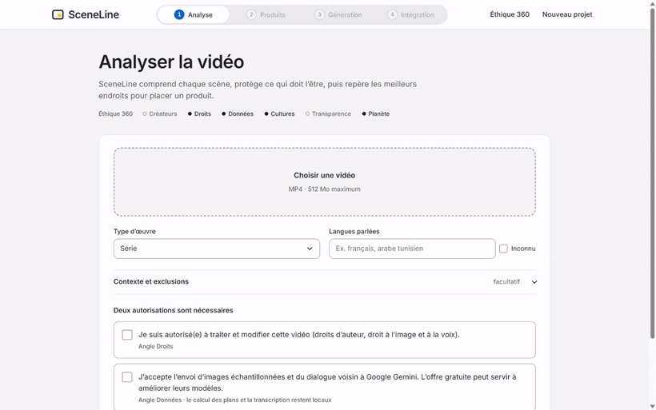
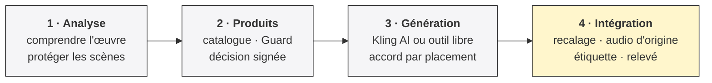
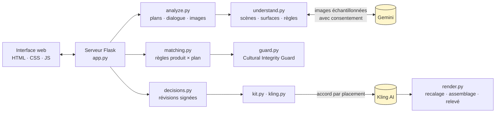

<div align="center">


### Le placement de produit virtuel qui respecte l'œuvre, sa culture et son public.

**L'IA propose. Le créateur décide. Le spectateur est informé.**

[](docs/ETHIQUE-360.md)
[](requirements.txt)
[](src/server/app.py)
[](src/video_analyzer/understand.py)
[](src/generation/kling.py)
[](src/integration/render.py)

[Démo](#-démonstration-réelle) · [Le problème](#-le-problème) · [Les 4 étapes](#-les-4-étapes) · [Architecture](#-architecture) · [Éthique 360](#-éthique-360) · [Stack](#-stack-technique) · [Lancer](#-lancer-sceneline)

</div>

---

## 🎬 Démonstration réelle

<div align="center">



</div>

> **Ceci n'est pas une maquette.** L'application réelle, enregistrée pendant son utilisation sur un épisode de série
> française (« BALTRINGUE #1 », 4 min 38, une cuisine de restaurant à Paris) : import et contexte, **analyse Gemini
> réelle**, ajout du catalogue à la main, appariement, **Cultural Integrity Guard**, décision signée, puis le plan
> généré par **Kling AI** et intégré dans l'épisode. Les attentes sont accélérées et signalées à l'écran ; rien
> n'est coupé ni simulé.
>
> 📺 **Version complète :** [`docs/media/demo.mp4`](docs/media/demo.mp4) · 🎥 **Vidéo de présentation (2 min 26) :** [`docs/media/SceneLine-presentation.mp4`](docs/media/SceneLine-presentation.mp4)

<div align="center">
<br>
<sub>Étape 4 · la version éditée, avec l'étiquette « Placement virtuel » et le repère jaune de l'intervalle modifié.</sub>
</div>

Ce que montre l'enregistrement, sur ce test :

| | Résultat réel |
|---|---|
| Analyse | **12 scènes**, **48 plans**, **27 intervalles examinés**, **8 placements proposés**, **4 scènes protégées** (7 intervalles jamais envoyés au modèle) |
| Sobriété | **4 min 16** de traitement, **58 appels** Gemini (1 au modèle complet, 57 au modèle léger), 389 images envoyées, **0 échec** |
| Badoit 1 L (France) | **Proposée** dans la cuisine : cohérence 9/10, discrétion 8/10, faisabilité 9/10, **risque faible** |
| Boga Cidre (Tunisie) | **Écartée, risque élevé** : la campagne vise la Tunisie, l'action se passe à Paris |
| Génération | Plan de travail en inox (00:30 – 00:40) régénéré par Kling AI 4.0, **recalé de 7,0 s à 9,5 s** sur le dialogue d'origine |
| Transparence | Étiquette « Placement virtuel · Badoit 1 L » et relevé des modifications |

---

## ❗ Le problème

Dans l'audiovisuel, un contrat de placement signé **tard** bouscule toute la chaîne : le producteur renégocie, le
scénariste réécrit des scènes déjà validées, les acteurs jouent un texte qui n'est plus le leur.

L'IA générative sait désormais **ajouter un objet dans un plan déjà tourné**. C'est une chance pour libérer le
tournage. Mais sans garde-fou, le même outil peut placer une marque dans une scène de deuil, imposer un produit
étranger dans un décor qui n'est pas le sien, modifier une œuvre sans l'accord de ses auteurs, et tromper le
spectateur.

## 💡 La solution

**SceneLine n'est pas un générateur de vidéo. C'est la couche de décision éthique qui manquait autour de la
génération.** Il comprend l'œuvre avant d'y toucher, protège ce qui doit l'être, explique chaque proposition,
laisse le créateur décider, et dit au spectateur ce qui a été ajouté.

| | Outil de génération seul | **SceneLine** |
|---|---|---|
| Où placer le produit ? | L'utilisateur devine | Chaque scène analysée, chaque surface notée et vérifiée sur six images |
| Scènes sacrées ou sensibles | Modifiables | **Protégées**, jamais envoyées à la recherche de surface |
| Produit hors de sa culture | Accepté | **Cultural Integrity Guard** : écarté, avec l'explication |
| Qui décide ? | L'outil | **Le créateur**, décision signée, datée, avec empreinte |
| Données | Envoyées sans le dire | **Consentement explicite** à chaque envoi, calcul lourd en local |
| Énergie | Générations d'essai | **Une génération par placement approuvé** |
| Synchronisation | Le plan généré dérive | **Recalage image par image** sur le dialogue d'origine |
| Le spectateur | Non informé | **Étiquette** et **relevé des modifications** |

➡️ Pourquoi cette approche est différente : [`docs/POURQUOI-SCENELINE.md`](docs/POURQUOI-SCENELINE.md)

---

## 🧭 Les 4 étapes



| Étape | Ce que fait SceneLine | Technologie | Documentation |
|---|---|---|---|
| **1 · Analyse** | Détecte les plans, transcrit le dialogue, comprend chaque scène (lieu, époque, ton, sensibilité), **protège** les scènes sensibles, cherche des surfaces **de coupe à coupe**, applique des **règles écrites**, vérifie les finalistes sur six images | PySceneDetect, faster-whisper, FFmpeg (local) · Gemini Flash et Flash-Lite (et transcription de la darija) | [Étape 1](docs/etapes/1-analyse.md) |
| **2 · Produits** | Catalogue avec origine, marchés et **provenance obligatoire** du visuel ; règles d'appariement ; **Cultural Integrity Guard** (5 critères) ; Accepter / Refuser / Ajuster, **signé et daté** | Python, Gemini Flash-Lite, SHA-256 | [Étape 2](docs/etapes/2-produits-et-guard.md) |
| **3 · Génération** | Kit complet (plan, asset, prompt FR/EN, prompt négatif) ; génération **Kling AI** avec la clé du créateur, **en mémoire seulement**, et son **accord pour ce placement** | Kling AI 4.0 API, lien public éphémère | [Étape 3](docs/etapes/3-generation.md) |
| **4 · Intégration** | Retrait des bandes noires, **recalage temporel par programmation dynamique**, assemblage avec l'**audio d'origine**, comparaison Original / Version éditée, étiquette, relevé | OpenCV, NumPy, FFmpeg | [Étape 4](docs/etapes/4-integration.md) |

---

## 🏗 Architecture



Trois principes structurent tout le code :

1. **Les temps viennent de la mesure, jamais du modèle.** PySceneDetect fixe les coupes ; tout intervalle est exact à l'image près.
2. **Le modèle note, le code décide, l'humain tranche.** Les décisions sont des règles Python lisibles ([`classify()`](src/video_analyzer/understand.py), [`product_matcher/matching.py`](src/product_matcher/matching.py), [`cultural_guard/guard.py`](src/cultural_guard/guard.py)) ; une réponse de modèle hors schéma devient « incertain », jamais une modification.
3. **L'original n'est jamais modifié.** Chaque version éditée est un nouveau fichier lié par son empreinte à la révision approuvée.

➡️ Diagrammes de séquence, modules, API REST et choix d'architecture : [`docs/ARCHITECTURE.md`](docs/ARCHITECTURE.md)

---

## 🌍 Éthique 360

Chaque angle du cahier des charges correspond à **un comportement du code**, visible dans l'interface
(chaque étape affiche les angles qu'elle sollicite, et la page *Éthique 360* de l'application relie chaque
engagement à l'endroit où le vérifier).

| Angle | Ce que SceneLine fait, concrètement |
|---|---|
| 🎨 **Créateurs** | Rien n'est modifié sans accord ; exclusions de catégories et d'intervalles ; décisions signées, datées, avec empreinte SHA-256 ; original intact |
| ⚖️ **Droits** | Deux autorisations obligatoires à l'import ; provenance et licence exigées pour chaque visuel ; accord par placement avant tout envoi à Kling |
| 🔒 **Données** | Plans et images calculés en local, transcription locale du français (la darija et l'arabe, au choix, par Gemini) ; scènes protégées jamais envoyées ; clé Kling en mémoire seulement ; appels et images envoyées affichés |
| 🌐 **Cultures et langues** | Cultural Integrity Guard (historique, culturel, narratif, sensibilité, intention artistique) ; cohérence géographique ; **la langue ne décide jamais du pays** |
| 👁 **Transparence** | Étiquette « Placement virtuel · Produit » ; relevé des modifications (outil, approbateur, empreintes) ; chaque proposition explique son *pourquoi* |
| 🌱 **Planète** | Aucune génération spéculative ; calcul lourd local ; modèle léger pour les volumes ; scores mis en cache |

➡️ Chaque mécanisme, avec la fonction qui l'implémente : [`docs/ETHIQUE-360.md`](docs/ETHIQUE-360.md)

---

## 🧰 Stack technique

| Couche | Technologie | Rôle |
|---|---|---|
| Serveur | **Python 3.11+**, **Flask 3.1** | API REST, file de travaux, reprise après interruption |
| Vidéo locale | **FFmpeg / FFprobe**, **PySceneDetect 0.7**, **OpenCV**, **NumPy** | Coupes, images, recadrage, recalage, assemblage |
| Parole locale | **faster-whisper 1.2** | Transcription horodatée du français, sur la machine |
| Darija et arabe | **Gemini Flash** (audio) | Réplique d'origine en caractères arabes + traduction française, horodatées |
| Compréhension | **Google Gemini** 3.5 Flash · 3.1 Flash-Lite | Scènes, surfaces, vérification, produits ; sorties JSON contraintes par schéma |
| Génération | **Kling AI 4.0** (API Omni-Video) | Régénération du plan avec le produit, à la demande |
| Interface | **HTML, CSS, JavaScript** sans framework | Lisible, auditable, sans compilation ; police Inter ; thème clair |
| Vidéo de présentation | **HyperFrames**, **GSAP**, Gemini TTS, ElevenLabs Sound Effects | La vidéo est elle-même du code ([`docs/VIDEO.md`](docs/VIDEO.md)) |

---

## 🚀 Lancer SceneLine

Prérequis : Python 3.11+, et `ffmpeg` / `ffprobe` dans le `PATH`.

```bash
python -m venv .venv
.venv/Scripts/python -m pip install -r requirements.txt     # Windows (sous Linux/macOS : .venv/bin/python)
```

Clés Gemini, côté serveur uniquement : variables `GEMINI_API_KEY` (puis `GEMINI_API_KEY_2` … `_5`), ou un fichier
`.gemini-keys` à la racine (une clé par ligne, ignoré par Git).

```bash
.venv/Scripts/python run.py --port 8000
```

Ouvrez <http://127.0.0.1:8000>. La clé Kling AI, facultative, se connecte dans l'interface à l'étape 3 ; elle reste
en mémoire et n'est jamais écrite sur le disque.

<details>
<summary><b>Rejouer la démonstration enregistrée</b></summary>

La démo de ce README est produite par un script qui pilote l'application réelle dans Chrome, comme un utilisateur :

```bash
.venv/Scripts/python -m pip install playwright
.venv/Scripts/python scripts/record_demo.py --video "chemin/vers/episode.mp4"
.venv/Scripts/python scripts/build_demo_video.py output/demo-recording docs/media/demo.mp4 --gif docs/media/demo.gif
```
</details>

---

## 📁 Structure du dépôt

Le code est organisé **par étape du parcours** : chaque module a son dossier et son propre README.

```
SceneLine/
├── run.py                       Point d'entrée : python run.py
├── src/
│   ├── server/                  Serveur Flask et API REST
│   ├── video_analyzer/          Étape 1 · plans, dialogue, scènes, protection, surfaces, règles de décision
│   ├── product_matcher/         Étape 2 · catalogue, provenance des visuels, appariement
│   ├── cultural_guard/          Étape 2 · Cultural Integrity Guard (5 critères, cohérence géographique)
│   ├── producer_review/         Étape 2 · propositions, révisions, décisions signées
│   ├── generation/              Étape 3 · kit de génération, Kling AI avec accord par placement
│   ├── integration/             Étape 4 · recalage temporel, assemblage, relevé des modifications
│   ├── evaluation/              Mesure de la qualité face à une annotation manuelle
│   └── web/                     Interface HTML · CSS · JS, sans framework
├── docs/                        Architecture, une page par étape, Éthique 360, vidéo, médias
├── demo_products/               Catalogue de démonstration, provenance de chaque visuel
├── validation/                  Annotation de référence de l'épisode de test
├── design/                      Système de design et prototype de l'interface
├── motion-video/                Vidéo de présentation, écrite en code (HyperFrames)
└── scripts/                     Enregistrement reproductible de la démo
```

| Module | README | Étape |
|---|---|---|
| `server` | [src/server](src/server) | API, file de travaux, garde d'hôte |
| `video_analyzer` | [src/video_analyzer](src/video_analyzer) | 1 · Analyse |
| `product_matcher` | [src/product_matcher](src/product_matcher) | 2 · Produits |
| `cultural_guard` | [src/cultural_guard](src/cultural_guard) | 2 · Éthique culturelle |
| `producer_review` | [src/producer_review](src/producer_review) | 2 · Décisions |
| `generation` | [src/generation](src/generation) | 3 · Génération |
| `integration` | [src/integration](src/integration) | 4 · Intégration |
| `web` | [src/web](src/web) | Interface |

---

## 📚 Documentation

| Document | Contenu |
|---|---|
| [Pourquoi SceneLine](docs/POURQUOI-SCENELINE.md) | Le problème, ce qui rend la solution différente, pour qui |
| [Architecture](docs/ARCHITECTURE.md) | Diagrammes, modules, API REST, choix techniques |
| [Étape 1 · Analyse](docs/etapes/1-analyse.md) | Pipeline, protection des scènes, intervalles, score, règles |
| [Étape 2 · Produits et Guard](docs/etapes/2-produits-et-guard.md) | Appariement, Cultural Integrity Guard, cohérence géographique, décisions signées |
| [Étape 3 · Génération](docs/etapes/3-generation.md) | Kit, Kling AI, sécurité de la clé, accord par placement |
| [Étape 4 · Intégration](docs/etapes/4-integration.md) | Recalage par programmation dynamique, assemblage, relevé |
| [Éthique 360](docs/ETHIQUE-360.md) | Les six angles, mécanisme par mécanisme, avec le code |
| [Vidéo de présentation](docs/VIDEO.md) | Comment la vidéo a été construite en code |

---

## 🙏 Crédits et droits

- Extraits de **« BALTRINGUE #1 »** et entretien de **Yasmine Dimassi** publié par **Nawaat** : utilisés uniquement
  pour démontrer le fonctionnement de SceneLine, ils restent la propriété de leurs auteurs. Les fichiers vidéo
  sources ne sont pas versionnés.
- **Badoit** et **Boga** sont des marques réelles utilisées comme exemples de test, sans partenariat ni soutien de
  ces marques. La provenance de chaque visuel est indiquée dans [`demo_products/`](demo_products).
- Projet réalisé pour le hackathon **« IA Éthique 360 »**.

<div align="center">

**L'IA propose. Le créateur décide. Le spectateur est informé.**

</div>
