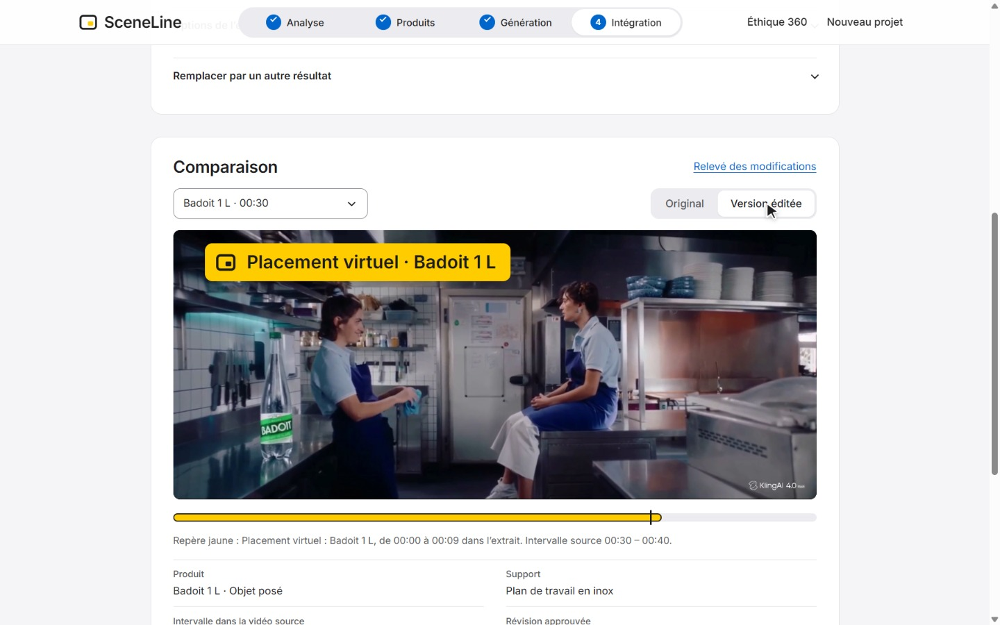
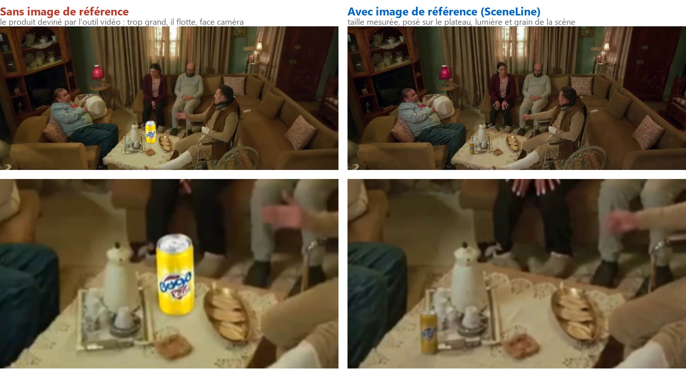
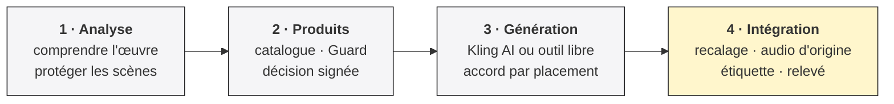
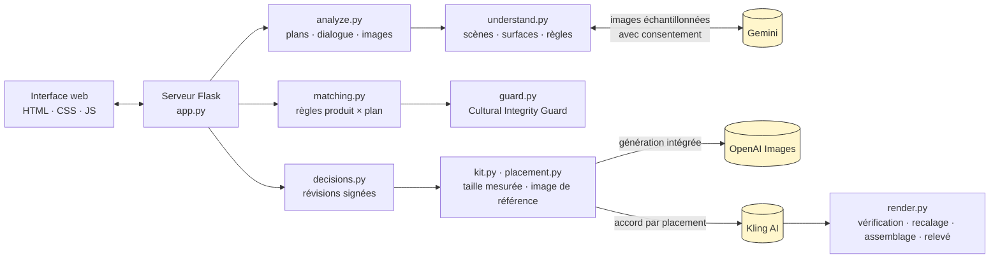

<div align="center">


### Le placement de produit virtuel qui respecte l'œuvre, sa culture et son public.

**L'IA propose. Le créateur décide. Le spectateur est informé.**

[](docs/ETHIQUE-360.md)
[](requirements.txt)
[](src/server/app.py)
[](src/video_analyzer/understand.py)
[](src/generation/kling.py)
[](src/integration/render.py)

[Démo](#-démonstration-réelle) · [Deux séries](#-deux-séries-deux-cultures-deux-langues) · [Image de référence](#-limage-de-référence-le-placement-ne-se-devine-plus) · [Le problème](#-le-problème) · [Les 4 étapes](#-les-4-étapes) · [Architecture](#-architecture) · [Éthique 360](#-éthique-360) · [Stack](#-stack-technique) · [Lancer](#-lancer-sceneline)

</div>

---

## 🎬 Démonstration réelle

<div align="center">


</div>

> **Ceci n'est pas une maquette.** L'application réelle, enregistrée pendant son utilisation sur un épisode de série
> française (« BALTRINGUE #1 », 4 min 38, une cuisine de restaurant à Paris) : import et contexte, **analyse Gemini
> réelle**, ajout du catalogue à la main, appariement, **Cultural Integrity Guard**, décision signée, puis le plan
> généré par **Kling AI** et intégré dans l'épisode. Les attentes sont accélérées et signalées à l'écran ; rien
> n'est coupé ni simulé.
>
> 📺 **Version complète :** [`docs/media/demo.mp4`](docs/media/demo.mp4) · 🎥 **Vidéo de présentation (2 min 26) :** [`docs/media/SceneLine-presentation.mp4`](docs/media/SceneLine-presentation.mp4)

<div align="center">
<br>
<sub>Étape 4 · la version éditée, avec l'étiquette « Placement virtuel » et le repère jaune de l'intervalle modifié.</sub>
</div>

---

## 🌍 Deux séries, deux cultures, deux langues

SceneLine a été testé de bout en bout sur **deux épisodes réels**, avec **les mêmes produits** : une série française
tournée à Paris, et une série tunisienne dialoguée en **darija**. Les deux parcours vont jusqu'au plan généré et
intégré dans l'épisode.

| | 🇫🇷 Série française · « BALTRINGUE #1 » | 🇹🇳 Série tunisienne |
|---|---|---|
| Épisode | 4 min 38 · cuisine de restaurant, Paris | 4 min 00 · salon familial à Tunis, puis une clinique |
| Langue | Français, transcrit **en local** (faster-whisper) | Darija tunisienne, transcrite par **Gemini** : **57 répliques**, chacune en arabe d'origine **et** en français |
| Analyse | 12 scènes · 48 plans · 27 intervalles · **8 placements** · 4 scènes protégées | 7 scènes · 67 plans · 30 intervalles · **8 placements** · aucune scène à protéger (comédie) |
| Sobriété | 4 min 16 · 58 appels · 389 images · 0 échec | 7 min 29 · 72 appels · 483 images |
| **Badoit 1 L** (marché : France) | ✅ **Proposée** dans la cuisine · risque faible | ⛔ **Écartée par le Guard sur 6 placements sur 6** : « l'action se passe à Tunis » |
| **Boga Cidre** (marché : Tunisie) | ⛔ **Écartée** : l'action se passe à Paris | ✅ **Proposée sur 6 placements** : « une boisson emblématique des foyers tunisiens » |
| Placement retenu | Badoit sur le plan de travail en inox (00:30 – 00:40) | Boga Cidre sur la table basse du salon (00:31 – 00:35) |
| Génération | Kling AI 4.0, **recalé de 7,0 s à 9,5 s** sur le dialogue | Kling AI, **taille mesurée** et **image de référence**, recalé de 5,0 s à 4,5 s |
| Intégration | Audio d'origine, étiquette, relevé | Vidéo **vérifiée comme étant celle de ce plan (ressemblance 99,6 %)**, 1 s d'original avant et après, audio d'origine |

**Mêmes produits, décisions inverses.** Le Cultural Integrity Guard ne réagit pas à une marque, mais au **lieu de
l'histoire déclaré par le producteur** et aux **marchés visés par la campagne**. La langue ne décide jamais du pays.

**La darija, comprise pour de vrai.** Whisper, conçu pour les grandes langues, transformait la darija en phrases
françaises inventées. SceneLine propose donc au producteur une transcription par Gemini pour la darija et l'arabe :
avec le vrai dialogue, la compréhension de l'épisode passe de « une discussion animée dans un salon » à « une
famille discute avec humour d'argent et de complexes autour d'un homme blessé, conduit ensuite à une clinique ».

---

## 🎯 L'image de référence : le placement ne se devine plus

<div align="center">
<br>
<sub>Le même plan de la série tunisienne. À gauche, l'outil vidéo seul (Kling AI 3.0 Omni) devine la taille et la
place : la canette est deux fois trop grande, flotte et fait face à la caméra. À droite, avec l'image de référence
préparée par SceneLine (Kling AI 4.0 Flash) : la taille mesurée, posée sur le plateau, avec la lumière et le grain
de la scène.</sub>
</div>

Laisser un outil vidéo deviner donne un produit trop grand, trop net, trop lumineux, « collé ». SceneLine ne lui
laisse plus rien à deviner :

1. **Mesure.** Gemini repère un objet voisin et sa taille réelle (ici une cafetière de 22 cm) ; le **code** en déduit
   la taille du produit à l'écran : la canette de 11,5 cm doit occuper **5,6 % de la hauteur de l'image, environ 60 px**.
2. **Accord avec la scène.** Le produit est réduit à cette taille, puis sa luminosité, sa couleur, sa netteté et son
   grain sont alignés sur l'endroit où il sera posé.
3. **Image de référence.** La première image du plan reçoit le produit, à la place et à la taille mesurées. L'outil
   vidéo la reçoit comme **premier plan attendu**, avec un prompt « MAIN REFERENCE » qui lui demande de la reproduire.
4. **Contrôle.** À l'intégration, SceneLine vérifie que la vidéo reçue est bien celle de ce plan, la recale sur le
   dialogue d'origine et la replace avec une seconde d'original avant et après.

➡️ Détails : [Étape 3 · placement mesuré et image de référence](docs/etapes/3-generation.md#placement-mesuré-et-image-de-référence)

---

## ❗ Le problème

Dans l'audiovisuel, un contrat de placement signé **tard** bouscule toute la chaîne : le producteur renégocie, le
scénariste réécrit des scènes déjà validées, les acteurs jouent un texte qui n'est plus le leur.

L'IA générative sait désormais **ajouter un objet dans un plan déjà tourné**. C'est une chance pour libérer le
tournage. Mais sans garde-fou, le même outil peut placer une marque dans une scène de deuil, imposer un produit
étranger dans un décor qui n'est pas le sien, modifier une œuvre sans l'accord de ses auteurs, et tromper le
spectateur.

## 💡 La solution

**SceneLine n'est pas un générateur de vidéo. C'est la couche de décision éthique qui manquait autour de la
génération.** Il comprend l'œuvre avant d'y toucher, protège ce qui doit l'être, explique chaque proposition,
laisse le créateur décider, et dit au spectateur ce qui a été ajouté.

| | Outil de génération seul | **SceneLine** |
|---|---|---|
| Où placer le produit ? | L'utilisateur devine | Chaque scène analysée, chaque surface notée et vérifiée sur six images |
| Scènes sacrées ou sensibles | Modifiables | **Protégées**, jamais envoyées à la recherche de surface |
| Produit hors de sa culture | Accepté | **Cultural Integrity Guard** : écarté, avec l'explication |
| Qui décide ? | L'outil | **Le créateur**, décision signée, datée, avec empreinte |
| Données | Envoyées sans le dire | **Consentement explicite** à chaque envoi, calcul lourd en local |
| Énergie | Générations d'essai | **Une génération par placement approuvé** |
| Synchronisation | Le plan généré dérive | **Recalage image par image** sur le dialogue d'origine |
| Le spectateur | Non informé | **Étiquette** et **relevé des modifications** |

➡️ Pourquoi cette approche est différente : [`docs/POURQUOI-SCENELINE.md`](docs/POURQUOI-SCENELINE.md)

---

## 🧭 Les 4 étapes



| Étape | Ce que fait SceneLine | Technologie | Documentation |
|---|---|---|---|
| **1 · Analyse** | Détecte les plans, transcrit le dialogue, comprend chaque scène (lieu, époque, ton, sensibilité), **protège** les scènes sensibles, cherche des surfaces **de coupe à coupe**, applique des **règles écrites**, vérifie les finalistes sur six images | PySceneDetect, faster-whisper, FFmpeg (local) · Gemini Flash et Flash-Lite (et transcription de la darija) | [Étape 1](docs/etapes/1-analyse.md) |
| **2 · Produits** | Catalogue avec origine, marchés et **provenance obligatoire** du visuel ; règles d'appariement ; **Cultural Integrity Guard** (5 critères) ; Accepter / Refuser / Ajuster, **signé et daté** | Python, Gemini Flash-Lite, SHA-256 | [Étape 2](docs/etapes/2-produits-et-guard.md) |
| **3 · Génération** | **Taille et place mesurées**, produit accordé à la scène, **image de référence**, prompt « MAIN REFERENCE » ; deux façons de générer : **avec vos outils**, ou **intégrée** (SceneLine appelle lui-même les API), toujours avec l'**accord pour ce placement** | Gemini, OpenCV, OpenAI Images, Kling AI | [Étape 3](docs/etapes/3-generation.md) |
| **4 · Intégration** | **Vérification que la vidéo est celle de ce plan**, retrait des bandes noires, **recalage temporel par programmation dynamique**, 1 s d'original avant et après, **audio d'origine**, comparaison, étiquette, relevé | OpenCV, NumPy, FFmpeg | [Étape 4](docs/etapes/4-integration.md) |

---

## 🏗 Architecture



Trois principes structurent tout le code :

1. **Les temps viennent de la mesure, jamais du modèle.** PySceneDetect fixe les coupes ; tout intervalle est exact à l'image près.
2. **Le modèle note, le code décide, l'humain tranche.** Les décisions sont des règles Python lisibles ([`classify()`](src/video_analyzer/understand.py), [`product_matcher/matching.py`](src/product_matcher/matching.py), [`cultural_guard/guard.py`](src/cultural_guard/guard.py)) ; une réponse de modèle hors schéma devient « incertain », jamais une modification.
3. **L'original n'est jamais modifié.** Chaque version éditée est un nouveau fichier lié par son empreinte à la révision approuvée.

➡️ Diagrammes de séquence, modules, API REST et choix d'architecture : [`docs/ARCHITECTURE.md`](docs/ARCHITECTURE.md)

---

## 🌍 Éthique 360

Chaque angle du cahier des charges correspond à **un comportement du code**, visible dans l'interface
(chaque étape affiche les angles qu'elle sollicite, et la page *Éthique 360* de l'application relie chaque
engagement à l'endroit où le vérifier).

| Angle | Ce que SceneLine fait, concrètement |
|---|---|
| 🎨 **Créateurs** | Rien n'est modifié sans accord ; exclusions de catégories et d'intervalles ; décisions signées, datées, avec empreinte SHA-256 ; original intact |
| ⚖️ **Droits** | Deux autorisations obligatoires à l'import ; provenance et licence exigées pour chaque visuel ; accord par placement avant tout envoi à Kling |
| 🔒 **Données** | Plans et images calculés en local, transcription locale du français (la darija et l'arabe, au choix, par Gemini) ; scènes protégées jamais envoyées ; clé Kling de SceneLine gardée sur le serveur, jamais affichée ; appels et images envoyées affichés |
| 🌐 **Cultures et langues** | Cultural Integrity Guard (historique, culturel, narratif, sensibilité, intention artistique) ; cohérence géographique ; **la langue ne décide jamais du pays** ; la **darija** transcrite pour de vrai, pas réinventée en français ; testé sur une série française **et** une série tunisienne |
| 👁 **Transparence** | Étiquette « Placement virtuel · Produit » ; relevé des modifications (outil, approbateur, empreintes) ; chaque proposition explique son *pourquoi* |
| 🌱 **Planète** | Aucune génération spéculative ; calcul lourd local ; modèle léger pour les volumes ; scores mis en cache |

➡️ Chaque mécanisme, avec la fonction qui l'implémente : [`docs/ETHIQUE-360.md`](docs/ETHIQUE-360.md)

---

## 🧰 Stack technique

| Couche | Technologie | Rôle |
|---|---|---|
| Serveur | **Python 3.11+**, **Flask 3.1** | API REST, file de travaux, reprise après interruption |
| Vidéo locale | **FFmpeg / FFprobe**, **PySceneDetect 0.7**, **OpenCV**, **NumPy** | Coupes, images, recadrage, recalage, assemblage |
| Parole locale | **faster-whisper 1.2** | Transcription horodatée du français, sur la machine |
| Darija et arabe | **Gemini Flash** (audio) | Réplique d'origine en caractères arabes + traduction française, horodatées |
| Compréhension | **Google Gemini** 3.5 Flash · 3.1 Flash-Lite | Scènes, surfaces, vérification, produits ; sorties JSON contraintes par schéma |
| Placement mesuré | **Gemini** (repérage) · **OpenCV** | Taille apparente calculée, produit accordé à la scène, image de référence |
| Image de référence | **OpenAI Images** (génération intégrée) ou l'outil du producteur | La première image du plan avec le produit en place |
| Génération | **Kling AI** 3.0 Omni · 4.0 (API Omni-Video) | Régénération du plan avec le produit, guidée par l'image de référence |
| Interface | **HTML, CSS, JavaScript** sans framework | Lisible, auditable, sans compilation ; police Inter ; thème clair |
| Vidéo de présentation | **HyperFrames**, **GSAP**, Gemini TTS, ElevenLabs Sound Effects | La vidéo est elle-même du code ([`docs/VIDEO.md`](docs/VIDEO.md)) |

---

## 🚀 Lancer SceneLine

Prérequis : Python 3.11+, et `ffmpeg` / `ffprobe` dans le `PATH`.

```bash
python -m venv .venv
.venv/Scripts/python -m pip install -r requirements.txt     # Windows (sous Linux/macOS : .venv/bin/python)
```

Clés Gemini, côté serveur uniquement : variables `GEMINI_API_KEY` (puis `GEMINI_API_KEY_2` … `_5`), ou un fichier
`.gemini-keys` à la racine (une clé par ligne, ignoré par Git).

```bash
.venv/Scripts/python run.py --port 8000
```

Ouvrez <http://127.0.0.1:8000>. Pour la génération automatique, SceneLine utilise **son propre compte Kling AI** :
placez la clé dans `KLING_API_KEY` (ou le fichier `.kling-key`) et l'adresse publique https du serveur dans
`SCENELINE_PUBLIC_URL` (ou `.sceneline-public-url`). Les créateurs n'ont aucune clé à fournir.
Voir [Étape 3 · configuration](docs/etapes/3-generation.md#configuration-du-serveur).

**Deux façons de générer, au choix à l'étape 3.**

| | **Avec vos outils** | **Génération intégrée** |
|---|---|---|
| Image de référence | Le producteur la produit avec l'outil de son choix (ChatGPT, Gemini…), à partir des images et du prompt mesuré fournis par SceneLine, puis l'importe | SceneLine l'obtient lui-même de l'API OpenAI Images |
| Vidéo | Kling AI par l'API ou tout autre outil vidéo, puis import | SceneLine l'envoie à Kling AI avec le prompt « MAIN REFERENCE » |
| Intégration | Vérification du bon plan, recalage, 1 s d'original avant et après | Identique |
| Ce qu'il faut | Rien de plus que SceneLine | Des crédits d'API : `OPENAI_API_KEY` (ou `.openai-key`) et la clé Kling de SceneLine |

Les deux versions suivent le même parcours et produisent le même résultat ; la génération intégrée évite seulement
au producteur de quitter SceneLine. Elle s'active dès que les clés d'API sont configurées sur le serveur
([détails](docs/etapes/3-generation.md#deux-versions-du-parcours)).

<details>
<summary><b>Réenregistrer la vidéo de démonstration du README</b></summary>

La démo de ce README est produite par un script qui pilote l'application réelle dans Chrome, comme un utilisateur :

```bash
.venv/Scripts/python -m pip install playwright
.venv/Scripts/python scripts/record_demo.py --video "chemin/vers/episode.mp4"
.venv/Scripts/python scripts/build_demo_video.py output/demo-recording docs/media/demo.mp4 --gif docs/media/demo.gif
```
</details>

---

## 📁 Structure du dépôt

Le code est organisé **par étape du parcours** : chaque module a son dossier et son propre README.

```
SceneLine/
├── run.py                       Point d'entrée : python run.py
├── src/
│   ├── server/                  Serveur Flask et API REST
│   ├── video_analyzer/          Étape 1 · plans, dialogue, scènes, protection, surfaces, règles de décision
│   ├── product_matcher/         Étape 2 · catalogue, provenance des visuels, appariement
│   ├── cultural_guard/          Étape 2 · Cultural Integrity Guard (5 critères, cohérence géographique)
│   ├── producer_review/         Étape 2 · propositions, révisions, décisions signées
│   ├── generation/              Étape 3 · kit de génération, Kling AI avec accord par placement
│   ├── integration/             Étape 4 · recalage temporel, assemblage, relevé des modifications
│   ├── evaluation/              Mesure de la qualité face à une annotation manuelle
│   └── web/                     Interface HTML · CSS · JS, sans framework
├── docs/                        Architecture, une page par étape, Éthique 360, vidéo, médias
├── demo_products/               Catalogue d'exemple, provenance de chaque visuel
├── validation/                  Annotation de référence de l'épisode de test
├── design/                      Système de design de l'interface (jetons, composants)
├── motion-video/                Vidéo de présentation, écrite en code (HyperFrames)
└── scripts/                     Enregistrement reproductible de la démo
```

| Module | README | Étape |
|---|---|---|
| `server` | [src/server](src/server) | API, file de travaux, garde d'hôte |
| `video_analyzer` | [src/video_analyzer](src/video_analyzer) | 1 · Analyse |
| `product_matcher` | [src/product_matcher](src/product_matcher) | 2 · Produits |
| `cultural_guard` | [src/cultural_guard](src/cultural_guard) | 2 · Éthique culturelle |
| `producer_review` | [src/producer_review](src/producer_review) | 2 · Décisions |
| `generation` | [src/generation](src/generation) | 3 · Génération |
| `integration` | [src/integration](src/integration) | 4 · Intégration |
| `web` | [src/web](src/web) | Interface |

---

## 📚 Documentation

| Document | Contenu |
|---|---|
| [Pourquoi SceneLine](docs/POURQUOI-SCENELINE.md) | Le problème, ce qui rend la solution différente, pour qui |
| [Architecture](docs/ARCHITECTURE.md) | Diagrammes, modules, API REST, choix techniques |
| [Étape 1 · Analyse](docs/etapes/1-analyse.md) | Pipeline, protection des scènes, intervalles, score, règles |
| [Étape 2 · Produits et Guard](docs/etapes/2-produits-et-guard.md) | Appariement, Cultural Integrity Guard, cohérence géographique, décisions signées |
| [Étape 3 · Génération](docs/etapes/3-generation.md) | Placement mesuré, image de référence, deux façons de générer, Kling AI, accord par placement |
| [Étape 4 · Intégration](docs/etapes/4-integration.md) | Vérification du bon plan, recalage par programmation dynamique, assemblage, relevé |
| [Éthique 360](docs/ETHIQUE-360.md) | Les six angles, mécanisme par mécanisme, avec le code |
| [Vidéo de présentation](docs/VIDEO.md) | Comment la vidéo a été construite en code |

---

## 🙏 Crédits et droits

- Extraits de **« BALTRINGUE #1 »**, d'un **épisode de série tunisienne** et entretien de **Yasmine Dimassi**
  publié par **Nawaat** : utilisés uniquement pour tester et démontrer le fonctionnement de SceneLine, ils restent
  la propriété de leurs auteurs. Les fichiers vidéo sources ne sont pas versionnés.
- **Badoit** et **Boga** sont des marques réelles utilisées comme exemples de test, sans partenariat ni soutien de
  ces marques. La provenance de chaque visuel est indiquée dans [`demo_products/`](demo_products).
- Projet réalisé pour le hackathon **« IA Éthique 360 »**.

<div align="center">

**L'IA propose. Le créateur décide. Le spectateur est informé.**

</div>
