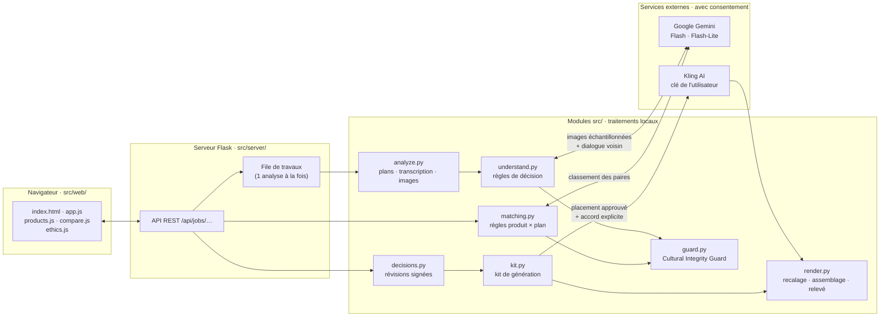
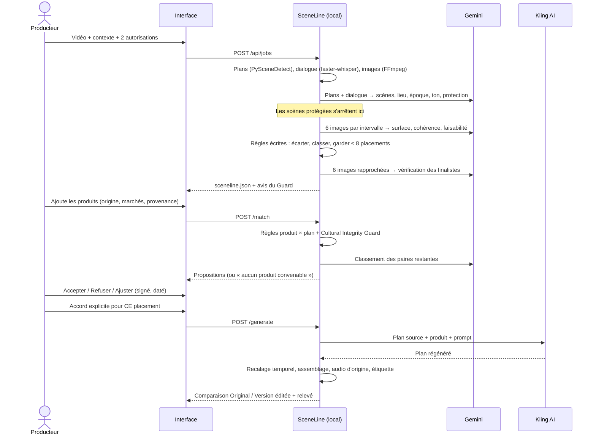

# Architecture

SceneLine est une application web locale : un serveur **Flask** (Python) orchestre des traitements vidéo
**locaux** (FFmpeg, PySceneDetect, faster-whisper, OpenCV) et des appels **ciblés** à des modèles
(Google Gemini pour la compréhension, Kling AI pour la génération, avec l'accord du créateur).
L'interface est écrite en HTML, CSS et JavaScript, sans framework ni étape de compilation.

> Principe directeur : **l'IA propose, le code décide selon des règles écrites, l'humain tranche.**
> Aucun modèle ne modifie l'œuvre de lui-même, et aucune règle de décision n'est laissée au texte libre d'un modèle.

---

## 1. Vue d'ensemble

Chaque projet vit dans son propre dossier `output/web-runs/<id>/` : la vidéo source (jamais modifiée),
les résultats JSON de chaque étape, les images de référence et le journal. Tout est relisible et rejouable.

---

## 2. Le parcours des données

---

## 3. Modules

| Étape | Module | Responsabilité |
|---|---|---|
| Serveur | [`server/app.py`](../src/server/app.py) | API REST, file de travaux, reprise après redémarrage, garde d'hôte (seul `/pub/` est servi à un hôte non local) |
| 1 · Préparation | [`video_analyzer/analyze.py`](../src/video_analyzer/analyze.py) | Métadonnées (ffprobe), plans (PySceneDetect), transcription horodatée (faster-whisper en local ; Gemini pour la darija et l'arabe, via [`transcribe.py`](../src/video_analyzer/transcribe.py)), une image par plan (FFmpeg) |
| 1 · Compréhension | [`video_analyzer/understand.py`](../src/video_analyzer/understand.py) | Scènes et contexte, protection éditoriale, intervalles de coupe à coupe, revue des surfaces, **règles de décision en code**, vérification des finalistes |
| 1 · Client Gemini | [`video_analyzer/understand.py`](../src/video_analyzer/understand.py) (`Gemini`) | Rotation des clés, mémoire des quotas épuisés, modèle de secours, sorties JSON contraintes par schéma |
| 1 · Contexte | [`video_analyzer/context.py`](../src/video_analyzer/context.py) | Type d'œuvre, lieu, époque, intention, exclusions de catégories et d'intervalles, consentements horodatés |
| 2 · Catalogue | [`product_matcher/catalog.py`](../src/product_matcher/catalog.py) | Fiches produit, provenance obligatoire du visuel, analyse du visuel, origine et marchés visés |
| 2 · Appariement | [`product_matcher/matching.py`](../src/product_matcher/matching.py) | Règles explicites produit × plan, puis classement Gemini des paires restantes ; scores mis en cache |
| 2 · Éthique | [`cultural_guard/guard.py`](../src/cultural_guard/guard.py) | **Cultural Integrity Guard** : cinq critères, risque faible / moyen / élevé, cohérence géographique |
| 2 · Décisions | [`producer_review/decisions.py`](../src/producer_review/decisions.py) | Propositions, révisions, décisions signées et datées, empreinte SHA-256 de chaque révision |
| 3 · Kit | [`generation/kit.py`](../src/generation/kit.py) | Plan source exact, asset du produit, prompt FR/EN, prompt négatif, réglages, archive ZIP |
| 3 · Génération | [`generation/kling.py`](../src/generation/kling.py) | API Kling AI : clé en mémoire, accord par placement vérifié côté serveur, lien public éphémère, suivi de tâche |
| 4 · Intégration | [`integration/render.py`](../src/integration/render.py) | Recalage temporel par programmation dynamique, retrait des bandes noires, assemblage avec l'audio d'origine, relevé des modifications |
| Évaluation | [`evaluation/evaluate.py`](../src/evaluation/evaluate.py) | Compare les placements à une annotation manuelle (`validation/`) |

---

## 4. API REST

Toutes les routes vivent sous `/api/jobs/<id>/` (identifiant de 32 caractères hexadécimaux, vérifié).

| Méthode | Route | Rôle |
|---|---|---|
| `POST` | `/api/jobs` | Crée un projet : vidéo MP4 (≤ 512 Mo), contexte, deux autorisations |
| `GET` | `/api/jobs/<id>` | État de l'analyse, résultat et avis du Guard |
| `POST` | `/api/jobs/<id>/resume` | Reprend une analyse interrompue là où elle s'est arrêtée |
| `GET` | `/api/jobs/<id>/project` | Catalogue, propositions, décisions, kits, rendus |
| `POST` | `/api/jobs/<id>/products` | Ajoute un produit (visuel + provenance obligatoire) |
| `PATCH` | `/api/jobs/<id>/context` | Déclare ou corrige le lieu, l'époque, l'intention |
| `POST` | `/api/jobs/<id>/match` | Lance l'appariement produits × placements |
| `POST` | `/api/jobs/<id>/proposals/<pid>/decision` | Accepter, refuser, ajuster, réviser (signé) |
| `POST` | `/api/jobs/<id>/opportunities/<key>/retain` | Retenir un placement mis en réserve |
| `POST` | `/api/jobs/<id>/opportunities/<key>/surfaces` | Chercher d'autres surfaces dans un plan |
| `POST` | `/api/jobs/<id>/proposals/<pid>/kit` | Prépare le kit de génération |
| `POST` | `/api/jobs/<id>/proposals/<pid>/generate` | Génère avec Kling AI (accord requis) |
| `POST` | `/api/jobs/<id>/proposals/<pid>/external` | Importe une vidéo produite avec un autre outil |
| `GET` | `/api/jobs/<id>/modifications.json` | Relevé des modifications de la version éditée |
| `POST/DELETE` | `/api/providers/kling/key` | Connecte ou oublie la clé Kling (mémoire seulement) |

---

## 5. Choix d'architecture

| Choix | Pourquoi |
|---|---|
| **Les temps viennent de la détection locale, jamais du modèle** | Un modèle de langage approxime les horodatages ; PySceneDetect les mesure. Chaque intervalle est donc exact à l'image près. |
| **Le contexte avant la surface** | Une scène est comprise (lieu, époque, ton, sensibilité) avant toute recherche d'emplacement. Une scène protégée n'est jamais envoyée à l'étape de placement : elle ne peut pas recevoir de produit, même par erreur. |
| **Des règles écrites, pas du texte libre** | `classify()` dans `understand.py` et les règles de `matching.py` sont du code lisible et testable. Le modèle note ; le code décide ; l'humain approuve. |
| **Deux modèles, chacun le secours de l'autre** | Le modèle complet pour le contexte et la protection, le modèle léger pour les volumes (intervalles, vérification, produits). Moins de calcul, même qualité de décision. |
| **Sorties JSON contraintes** | Chaque appel Gemini impose un schéma ; toute réponse invalide devient « incertain », jamais une décision. |
| **Fichiers JSON par projet** | Pas de base de données à installer ; chaque étape est relisible, auditable et rejouable. Écriture atomique (`replace_json`). |
| **Reprise après interruption** | Une analyse interrompue reprend là où elle s'est arrêtée ; les scores d'appariement déjà calculés sont conservés. |
| **Front-end sans framework** | Aucune dépendance JavaScript, aucune compilation : l'interface se lit et s'audite directement. |
| **L'original n'est jamais modifié** | Toute version éditée est un nouveau fichier lié à la révision approuvée par son empreinte. |
