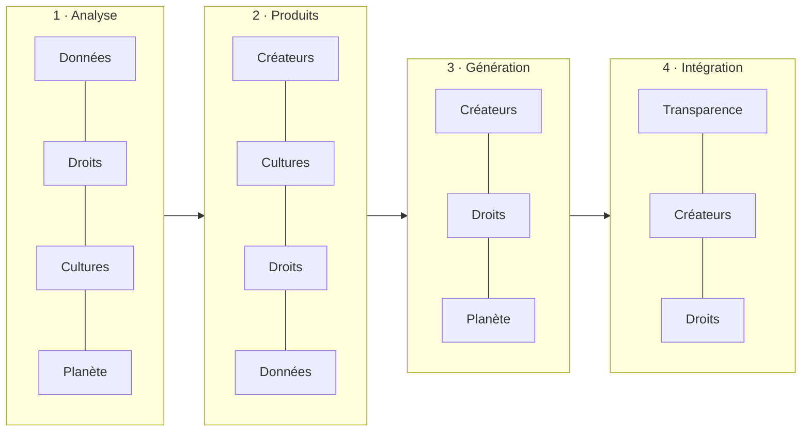

# Éthique 360 · six angles, des mécanismes concrets

SceneLine n'ajoute pas l'éthique après coup : chaque angle du cahier des charges correspond à un
**comportement du code**, visible dans l'interface. Chaque étape affiche en tête les angles qu'elle sollicite,
et la page **Éthique 360** de l'application relie chaque engagement à l'endroit où le vérifier.

---

## 1 · Les créateurs : *qui garde la main ?*

| Mécanisme | Où dans le code |
|---|---|
| Rien n'est modifié sans l'accord du producteur : Accepter, Refuser, Ajuster, Retenir, Choisir une autre surface | [`producer_review/decisions.py`](../src/producer_review/decisions.py) · `decide()` |
| Le producteur exclut des catégories et des intervalles, et déclare le contexte | [`video_analyzer/context.py`](../src/video_analyzer/context.py) |
| Chaque décision est **signée, datée, liée à une révision par empreinte SHA-256**, dans un journal | [`producer_review/decisions.py`](../src/producer_review/decisions.py) · `digest()` |
| La vidéo originale n'est **jamais modifiée** ; une révision modifiée après approbation doit être décidée à nouveau | [`integration/render.py`](../src/integration/render.py) |
| Les règles de décision sont du code lisible, pas le texte libre d'un modèle | [`video_analyzer/understand.py`](../src/video_analyzer/understand.py) · `classify()` |
| *En développement* · un créateur qui n'a pas encore de sponsor (parcours **Recherche d'opportunités**) garde la main sur la décision de démarcher ou non ; aucune garantie de revenu n'est jamais affichée comme un fait | [`opportunity_finder/report.py`](../src/opportunity_finder/report.py) |

## 2 · Les droits : *consentement, droits d'auteur, droit à l'image*

| Mécanisme | Où dans le code |
|---|---|
| **Deux autorisations obligatoires** à l'import (traiter l'œuvre ; envoyer des images à Gemini), horodatées | [`video_analyzer/context.py`](../src/video_analyzer/context.py), [`web/index.html`](../src/web/index.html) |
| Chaque visuel de produit exige une **provenance et une licence déclarées** | [`product_matcher/catalog.py`](../src/product_matcher/catalog.py) |
| Envoi à Kling : **accord par placement**, vérifié côté serveur | [`generation/kling.py`](../src/generation/kling.py) · `start()` |
| Le relevé rappelle qu'il ne remplace pas les obligations légales de signalement | [`integration/render.py`](../src/integration/render.py) |

## 3 · Les données : *d'où viennent-elles, où vont-elles ?*

| Mécanisme | Où dans le code |
|---|---|
| Plans, transcription et images sont calculés **en local** ; seules des images échantillonnées et le dialogue voisin partent vers Gemini | [`video_analyzer/analyze.py`](../src/video_analyzer/analyze.py), [`video_analyzer/understand.py`](../src/video_analyzer/understand.py) |
| Les **scènes protégées ne sont jamais envoyées** à la recherche de surface | [`video_analyzer/understand.py`](../src/video_analyzer/understand.py) |
| Le modèle utilisé, le nombre d'appels et d'images envoyées sont **affichés** | `metrics` dans `sceneline.json` |
| La clé Kling reste **en mémoire**, jamais sur disque ni dans un journal ; le plan n'est servi que par un lien aléatoire éphémère | [`generation/kling.py`](../src/generation/kling.py), [`server/app.py`](../src/server/app.py) · `before_request` |
| Tous les fichiers restent dans le dossier du projet | `output/web-runs/<id>/` |

## 4 · Cultures et langues : *quelles cultures le modèle met-il en avant, ou efface-t-il ?*

| Mécanisme | Où dans le code |
|---|---|
| **Cultural Integrity Guard** : cinq critères (historique, culturel, narratif, sensibilité, intention artistique), risque faible / moyen / élevé, justification pour chacun | [`cultural_guard/guard.py`](../src/cultural_guard/guard.py) · `assess()` |
| Scènes sacrées, traditionnelles, commémoratives, sensibles, titres et génériques **protégés** : aucun placement | [`cultural_guard/guard.py`](../src/cultural_guard/guard.py) · `assess_scene()` |
| **Cohérence géographique** : le lieu est déclaré, chaque produit porte une origine et des marchés visés ; un produit hors marché est écarté | [`cultural_guard/guard.py`](../src/cultural_guard/guard.py) · `geographic()` |
| **La langue parlée ne décide jamais du pays** de l'histoire : une œuvre francophone peut se passer à Tunis, Dakar ou Montréal | [`cultural_guard/guard.py`](../src/cultural_guard/guard.py) · `setting_country()` |
| Une scène est protégée seulement au moment sensible, pas sur tout le thème de l'œuvre | prompt de scènes, [`video_analyzer/understand.py`](../src/video_analyzer/understand.py) |

## 5 · La transparence : *le public sait-il ce qui a été généré ?*

| Mécanisme | Où dans le code |
|---|---|
| Étiquette **« Placement virtuel · [Produit] »** dans le lecteur pendant toute la durée du placement | [`web/compare.js`](../src/web/compare.js) |
| **Relevé des modifications** : produit, intervalle, empreinte, approbateur, date, outil, audio, avertissements, `generated_by_sceneline: false` | [`integration/render.py`](../src/integration/render.py) |
| Repères jaunes sur la frise : où la vidéo a été modifiée | [`web/compare.js`](../src/web/compare.js) |
| Chaque proposition explique **pourquoi** cette surface, ce produit, ce risque | [`web/products.js`](../src/web/products.js) |
| L'application dit aussi **ce qu'elle ne fait pas** (page Éthique 360) | [`web/ethics.js`](../src/web/ethics.js) |
| *En développement* · parcours **Recherche d'opportunités** : annuaire d'annonceurs marqué **« Annuaire de démonstration »** (3 à 5 annonceurs fictifs) ; sans correspondance, des types de partenaires génériques, jamais une entreprise réelle non inscrite ; avertissement que les revenus dépendent des accords conclus avec les annonceurs | [`opportunity_finder/advertisers.py`](../src/opportunity_finder/advertisers.py) |

## 6 · La planète : *quel coût énergétique pour quel bénéfice ?*

| Mécanisme | Où dans le code |
|---|---|
| **Aucune génération spéculative** : une vidéo n'est générée que pour un placement approuvé, un par un | [`generation/kling.py`](../src/generation/kling.py), [`generation/kit.py`](../src/generation/kit.py) |
| Le travail lourd est **local** ; le modèle léger traite les appels nombreux ; le modèle complet ne sert qu'au contexte | [`video_analyzer/understand.py`](../src/video_analyzer/understand.py) |
| Un appel par intervalle, **scores mis en cache** : un nouveau sponsor ne recalcule que les paires nouvelles | [`product_matcher/matching.py`](../src/product_matcher/matching.py) |
| Les scènes protégées et les intervalles exclus ne coûtent aucun appel | [`video_analyzer/understand.py`](../src/video_analyzer/understand.py) |
| Le nombre d'appels et d'images envoyées est affiché | `metrics` |

---

## En une phrase
> **L'IA propose. Le créateur décide. Le spectateur est informé.**
