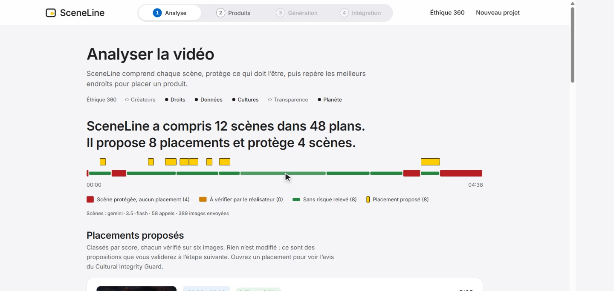
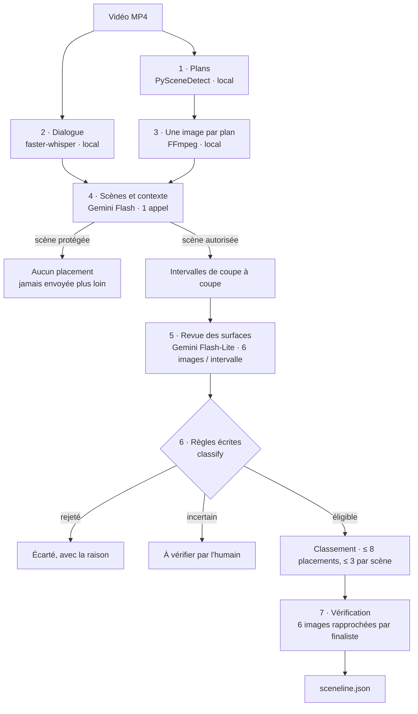

# Étape 1 · Analyser la vidéo

> **Objectif :** comprendre l'œuvre **avant** de chercher où placer un produit, protéger ce qui doit l'être,
> puis proposer seulement les meilleurs emplacements, chacun justifié et vérifié.



## Ce que voit le producteur

1. Il choisit la vidéo, indique le type d'œuvre et les langues.
2. Il peut déclarer le **contexte** (lieu, époque, intention narrative), **exclure des catégories** de produits
   (alcool, tabac…) et **des intervalles** à ne jamais modifier.
3. Il donne **deux autorisations explicites** : le droit de traiter l'œuvre, et l'envoi d'images échantillonnées
   à Google Gemini. Sans elles, le bouton d'analyse reste inactif.
4. Il suit l'analyse en six phases, puis découvre une **carte de la vidéo** : les scènes colorées par niveau de
   risque, les placements proposés, les scènes protégées par le Cultural Integrity Guard.

## Le pipeline



| Phase | Outil | Où | Rôle |
|---|---|---|---|
| 1 · Plans | PySceneDetect | local | Limites de plans : **seule source des temps** |
| 2 · Dialogue | faster-whisper | local | Transcription horodatée |
| 3 · Images | FFmpeg | local | Une image de référence par plan |
| 4 · Scènes | Gemini Flash | 1 appel | Regroupe les plans en scènes : action, lieu, époque, ton, indices culturels, **protection éditoriale** |
| 5 · Surfaces | Gemini Flash-Lite | 1 appel par intervalle | Surface, cohérence éditoriale, faisabilité visuelle, occultation, catégories compatibles |
| 6 · Classement | Règles en Python | local | Écarte, classe, garde au plus 8 placements (3 par scène) |
| 7 · Vérification | Gemini Flash-Lite | 1 appel par finaliste | Confirme que la surface reste libre et visible sur six images rapprochées |

Code : [`video_analyzer/analyze.py`](../../src/video_analyzer/analyze.py) (phases 1 à 3), [`video_analyzer/understand.py`](../../src/video_analyzer/understand.py) (phases 4 à 7),
[`video_analyzer/context.py`](../../src/video_analyzer/context.py) (contexte et consentements).

## La logique, en détail

### Le contexte avant la surface
Gemini reçoit d'abord **toute la vidéo résumée** (images de référence + dialogue) et la découpe en scènes avec
leur lieu, leur époque, leur ton et une décision de **protection** : `protected`, `clear` ou `uncertain`.
Une scène protégée (générique, rite, tradition, deuil, moment sensible, exclusion du producteur)
**n'est jamais envoyée à la recherche de surface**. La protection ne s'applique qu'au moment sensible,
pas à tout le thème de l'œuvre.

### Des intervalles alignés sur le montage
Un produit qui apparaît au milieu d'un plan se remarque. Les intervalles sont donc découpés **de coupe à coupe** :
un plan de moins de 14 s est examiné en entier, un plan plus long est découpé en parties d'environ 8 s, avec une
marge de 250 ms autour des coupes. Une sonde dédiée vérifie les **titres et sous-titres incrustés** près de
chaque coupe et recale l'intervalle si besoin.

### Un score lisible
```python
score = 0.5 × cohérence éditoriale + 0.5 × faisabilité visuelle
      − pénalités d'occultation et de gêne pour l'action
      − pénalité de visibilité (partielle : 1,5 · nulle : 4)
      − 1,5 si le contexte est incertain
      − 0,5 par extrémité qui ne tombe pas sur une coupe
```

### Le modèle note, le code décide
La fonction `classify()` applique des règles écrites, dans cet ordre :
titre ou générique → rejet · coupure dans l'intervalle → incertain · aucune surface → rejet ·
surface non localisée → incertain · incompatible avec la scène → rejet · non visible tout du long → rejet ·
occultation ou gêne élevée → rejet · score < 6,5 (ou cohérence < 6, faisabilité < 5) → rejet ·
scène à sensibilité incertaine → incertain · sinon **éligible**.

Toute réponse du modèle hors schéma devient « incertain », jamais une décision. **« Aucun placement » est un
résultat valide.**

### Le producteur garde la main
Il peut **retenir** un placement mis en réserve ou incertain (jamais un placement écarté par une règle),
et **chercher d'autres surfaces** dans un plan (jusqu'à trois, notées). Chaque choix est daté, signé, et garde
la proposition d'origine de SceneLine.

## Sobriété
- Les traitements lourds (plans, transcription, images) restent **locaux**.
- Le modèle complet ne sert qu'au contexte (1 appel) ; le modèle léger traite les volumes.
- Les clés tournent, un quota épuisé est mémorisé, et chaque modèle est le secours de l'autre.
- Le nombre d'appels et d'images envoyées est **affiché** au producteur.

## Résultat
`sceneline.json` : scènes, opportunités classées (surface, intervalle, score, catégories compatibles et à éviter,
raison), avis du Guard par scène, et mesures du traitement (durée, appels, images envoyées).
