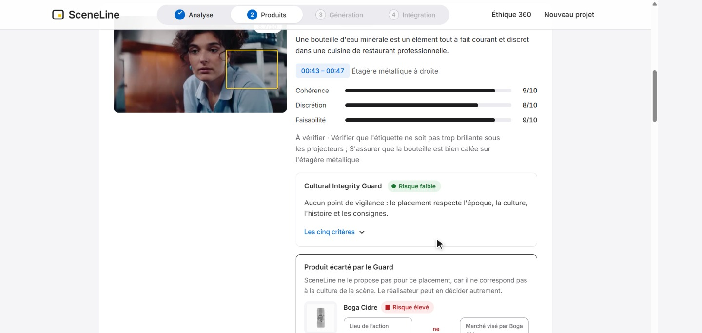
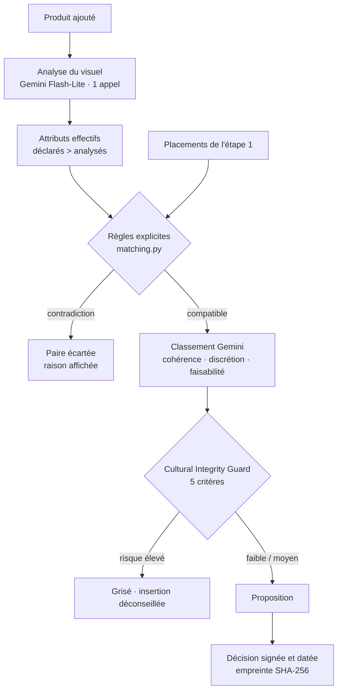

# Étape 2 · Produits, Cultural Integrity Guard et décisions

> **Objectif :** associer les produits du sponsor aux bons plans **sans trahir l'œuvre**, expliquer chaque
> proposition, et ne rien modifier sans l'accord signé du producteur.

## Ce que voit le producteur

1. Le **contexte de l'œuvre** en tête de page (lieu, époque, intention), modifiable à tout moment.
2. Le **catalogue** : il ajoute chaque produit avec sa catégorie, sa taille, son **pays d'origine**, ses
   **marchés visés** et la **provenance du visuel** (obligatoire : chaque image doit avoir une origine et une licence).
3. **Lancer l'appariement** : SceneLine propose, pour chaque placement, le produit le plus cohérent.
4. Chaque proposition affiche le plan, le produit, le score, l'avis du **Cultural Integrity Guard**, et trois
   actions : **Accepter**, **Refuser**, **Ajuster…** (décaler, réduire, changer de produit, d'intervalle).
5. Un produit à **risque élevé** apparaît grisé, avec la comparaison « Lieu de l'action ≠ Marché visé ».

## Le pipeline

Code : [`product_matcher/catalog.py`](../../src/product_matcher/catalog.py), [`product_matcher/matching.py`](../../src/product_matcher/matching.py), [`cultural_guard/guard.py`](../../src/cultural_guard/guard.py),
[`producer_review/decisions.py`](../../src/producer_review/decisions.py).

## Les règles d'appariement (avant tout modèle)
Une paire produit × plan est écartée, **avec une explication**, si : la catégorie est exclue par le producteur,
l'intervalle est exclu, le mode d'intégration n'est pas possible, la taille ne convient pas à la surface,
le produit est contemporain dans une scène d'époque, ou la scène interdit cette catégorie.
Seules les paires restantes sont classées par Gemini. Sous 6,5/10 (ou un critère sous 5), le résultat est
**« aucun produit convenable »**, un résultat valide.

Les scores déjà calculés sont **mis en cache** : ajouter un sponsor ne recalcule que les paires nouvelles.

## Cultural Integrity Guard
Pour chaque scène et chaque paire produit × placement, le Guard rend un risque **faible, moyen ou élevé** avec une
justification pour cinq critères. Il ne fait **aucun appel supplémentaire à un modèle** : il rassemble et explique
les signaux déjà calculés.

| Critère | Ce qui est vérifié |
|---|---|
| **Contexte historique** | Un produit contemporain dans une scène d'époque est un anachronisme (risque élevé) |
| **Contexte culturel** | Rites, traditions, patrimoine, deuil, fêtes religieuses ; **cohérence géographique** entre le lieu de l'action et les marchés du produit |
| **Cohérence narrative** | Cohérence avec l'histoire (/10) et gêne pour l'action |
| **Sensibilité de la scène** | Scène protégée, à vérifier, ou à moins de 6 s d'une scène protégée |
| **Intention artistique** | Respect des intervalles et catégories exclus par le réalisateur |

Le niveau global est le **pire des cinq**. Un risque élevé déclenche l'alerte « insertion déconseillée » ;
la décision finale reste au réalisateur.

### Cohérence géographique
Le lieu de l'action est **déclaré par le producteur** (ou relevé explicitement dans la scène).
**La langue parlée ne sert jamais à situer l'histoire** : une série francophone peut se passer à Tunis,
à Montréal ou à Dakar. Chaque produit porte une origine et des marchés visés par la campagne.
Si le lieu déclaré n'est pas un marché de la campagne, le risque est **élevé** et le produit est retiré des
propositions, avec cette explication :

> *L'action se passe en France (déclaré par le producteur). Boga Cidre est une marque tunisienne dont la campagne
> vise : Tunisie. Dans ce décor, elle ne correspondrait ni au lieu ni au public de l'œuvre et nuirait à son
> authenticité culturelle.*

Si le lieu n'est pas déclaré, le critère n'est pas évalué, et SceneLine le dit.

## Décisions signées
Chaque proposition a des **révisions**. Chaque décision (accepter, refuser, ajuster, réviser) enregistre
le nom de l'approbateur, la date, un commentaire et l'**empreinte SHA-256** de la révision décidée.
Si une révision change après approbation, l'ancienne reste approuvée et la nouvelle doit être décidée à son tour.
Le journal des décisions est visible dans l'interface et exporté avec le projet.
