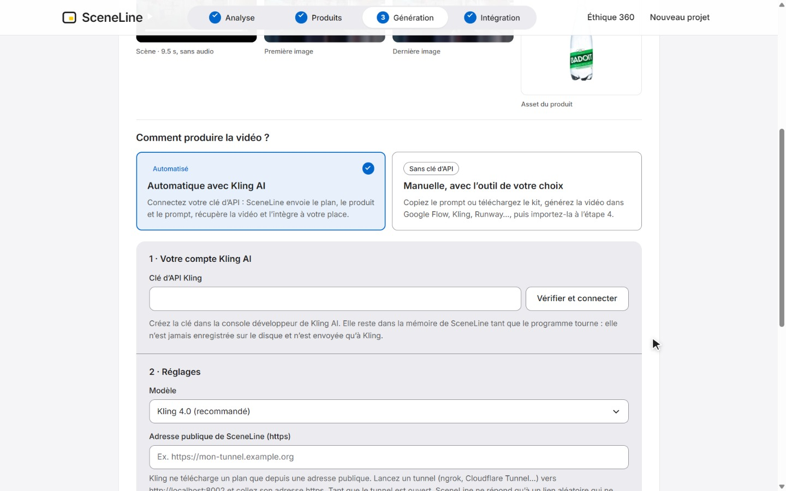
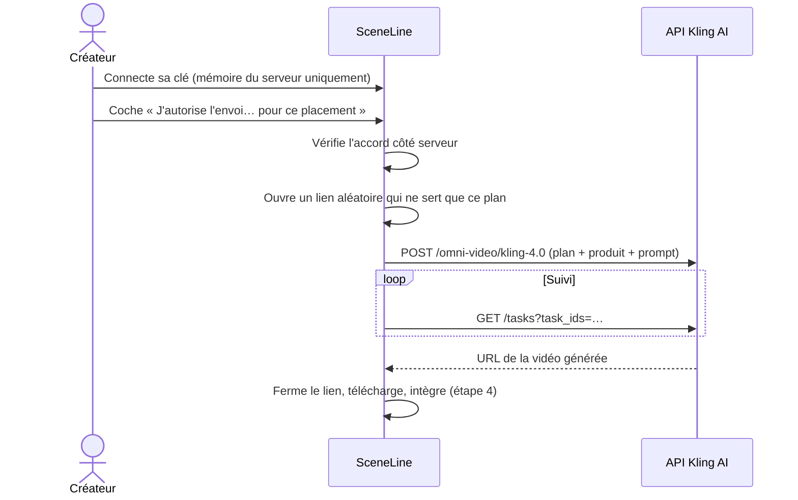

# Étape 3 · Génération

> **Objectif :** produire le plan modifié **uniquement pour un placement approuvé**, avec l'outil de génération
> choisi par le créateur, et **seulement après son accord explicite** pour ce placement.

## Deux façons de produire le plan

| | **Automatique avec Kling AI** | **Manuelle, avec l'outil de votre choix** |
|---|---|---|
| Principe | SceneLine envoie le plan, le produit et le prompt à Kling AI, suit la tâche, récupère la vidéo et l'intègre | SceneLine prépare un kit complet (ZIP) ; le créateur génère dans Google Flow, Kling, Runway… puis importe le résultat |
| Clé | La clé d'API du créateur, **en mémoire seulement** | Aucune clé |
| Accord | Case à cocher **par placement**, vérifiée **côté serveur** | Le créateur envoie lui-même |
| Code | [`generation/kling.py`](../../src/generation/kling.py) | [`generation/kit.py`](../../src/generation/kit.py) |

## Le kit de génération
Pour un placement approuvé, [`generation/kit.py`](../../src/generation/kit.py) assemble :
- **la scène** : le plan source exact (sans audio), découpé sur l'intervalle approuvé ;
- **l'asset** : le visuel propre du produit, sur un fond carré de 1024 px ;
- **le prompt**, en français et en anglais : la description du plan (rédigée par Gemini à partir de trois images),
  l'emplacement précis sur une surface existante, **ce qui ne doit pas changer** (personnes, décor, cadrage,
  rythme des gestes), un **prompt négatif** et des réglages conseillés ;
- une **empreinte du prompt**, qui suivra le résultat jusqu'au relevé de l'étape 4.

## Génération automatique avec Kling AI

### Sécurité et vie privée, par conception
- **La clé** reste dans la mémoire du serveur : jamais écrite sur disque, jamais dans un journal, envoyée
  uniquement à l'API de Kling. Un bouton la fait oublier immédiatement.
- **Rien ne part sans accord** : chaque placement demande sa propre autorisation, vérifiée côté serveur
  (une requête sans accord est refusée).
- **Ce qui sera envoyé est listé** avant l'envoi : le plan, l'image du produit, le prompt.
- **Le plan vidéo** n'est exposé que par un lien aléatoire, valable pendant la génération seulement,
  qui ne sert que ce fichier. Le serveur refuse toute autre route aux hôtes non locaux.
- **Seul le plan vidéo** est envoyé, jamais des images de début et de fin : générer à partir de deux images
  réinvente la scène, alors que partir du plan conserve le jeu des acteurs.

## Pourquoi c'est sobre
La génération vidéo est l'opération la plus coûteuse en énergie. SceneLine ne la déclenche **que** pour les
placements que le créateur a approuvés, un par un. Aucune génération spéculative, aucun lot automatique.
