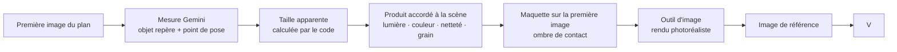
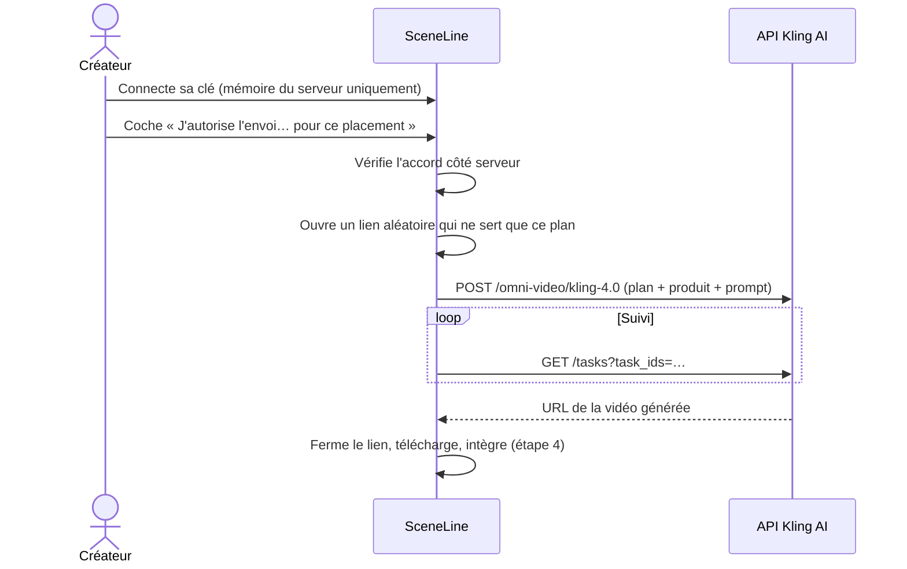

# Étape 3 · Génération

> **Objectif :** produire le plan modifié **uniquement pour un placement approuvé**, avec l'outil de génération
> choisi par le créateur, et **seulement après son accord explicite** pour ce placement.

## Placement mesuré et image de référence

Un outil vidéo à qui l'on laisse deviner la taille et la lumière rend un produit trop grand, trop net, trop
lumineux, « collé ». SceneLine ne lui laisse plus deviner :

1. **Mesure.** Gemini repère un objet voisin de taille connue (sa boîte dans l'image, sa taille réelle) et le
   point où poser le produit. Le **code** calcule la taille apparente : taille du produit ÷ taille du repère ×
   hauteur du repère dans l'image. Exemple : une canette de 11,5 cm à côté d'une cafetière de 22 cm qui occupe
   10,7 % de l'image doit occuper **5,6 %** (environ 60 px sur 1 080).
2. **Accord avec la scène.** Le visuel est réduit à cette taille (il perd le détail que la caméra ne verrait
   pas), puis sa luminosité, sa dominante, sa saturation, sa netteté et son grain sont alignés sur la zone de pose.
3. **Maquette.** Le produit accordé est posé sur la première image, avec une ombre de contact.
4. **Image de référence (obligatoire).** Le producteur donne à un outil d'image (ChatGPT, Gemini…) la
   première image du plan, la photo du produit et sa planche d'angles, avec le prompt de SceneLine : il y
   trouve la place et la taille mesurées, la lumière et le rendu attendus. L'image importée
   (cadrage vérifié) est envoyée à l'outil vidéo comme **première image attendue**. Dans l'interface, l'étape 3
   se fait en trois temps : **1 · kit**, **2 · image de référence**, **3 · vidéo** ; la génération reste
   verrouillée, dans l'interface comme sur le serveur, tant que l'image de référence n'est pas importée.

   Dès qu'elle est importée, l'image de référence **devient la consigne principale** : le prompt s'ouvre sur elle
   (« MAIN REFERENCE »), demande de reproduire le produit exactement comme sur cette image (place, taille, angle,
   lumière, ombre, rendu) et retire tout ce qui pourrait la contredire. Les photos du produit ne servent plus qu'à
   garder l'étiquette exacte ; tout le reste (caméra, personnes, gestes, rythme) vient de la vidéo d'origine.

Le prompt vidéo reprend la taille chiffrée, le point de pose, la lumière, l'ombre et le rendu de caméra, et
demande un objet posé comme un vrai accessoire (tourné, jamais face caméra comme une publicité). Une **version
courte** (moins de 3 000 caractères) est prête pour Kling 3.0 Omni, dont la limite est de 3 072 caractères.

## Deux façons de produire le plan

| | **Automatique avec Kling AI** | **Manuelle, avec l'outil de votre choix** |
|---|---|---|
| Principe | SceneLine envoie le plan, le produit et le prompt à Kling AI, suit la tâche, récupère la vidéo et l'intègre | SceneLine prépare un kit complet (ZIP) ; le créateur génère dans Google Flow, Kling, Runway… puis importe le résultat |
| Clé | **Aucune pour le créateur** : SceneLine génère avec son propre compte Kling (clé sur le serveur). Sans clé serveur, le créateur peut connecter la sienne, **en mémoire seulement** | Aucune clé |
| Accord | Case à cocher **par placement**, vérifiée **côté serveur** | Le créateur envoie lui-même |
| Code | [`generation/kling.py`](../../src/generation/kling.py) | [`generation/kit.py`](../../src/generation/kit.py) |

## Le kit de génération
Pour un placement approuvé, [`generation/kit.py`](../../src/generation/kit.py) assemble :
- **la scène** : le plan source exact (sans audio), découpé sur l'intervalle approuvé ;
- **l'asset** : le visuel propre du produit, sur un fond carré de 1024 px, et sa **planche d'angles** si le producteur l'a importée ;
- **le prompt**, en français et en anglais : la description du plan (rédigée par Gemini à partir de trois images),
  l'emplacement précis sur une surface existante, **ce qui ne doit pas changer** (personnes, décor, cadrage,
  rythme des gestes), un **prompt négatif** et des réglages conseillés ;
- **le réalisme**, décrit par Gemini à partir des images du plan : la **taille réelle** du produit, sa **taille
  apparente** comparée aux objets voisins et en pourcentage de l'image, la **direction et la couleur de la
  lumière**, l'**ombre** cohérente avec celles du décor, le **rendu de caméra** (netteté, grain, étalonnage) et ce
  qui passe devant. Le produit doit sembler filmé avec le plan, jamais plus net ni plus propre que son entourage ;
- une **empreinte du prompt**, qui suivra le résultat jusqu'au relevé de l'étape 4.

## Génération automatique avec Kling AI

### Configuration du serveur
Le compte Kling de SceneLine se configure sur le serveur, jamais dans l'interface :

| Réglage | Variable d'environnement | ou fichier (non versionné) |
|---|---|---|
| Clé d'API Kling de SceneLine | `KLING_API_KEY` | `.kling-key` |
| Adresse publique du serveur (https), par laquelle Kling télécharge le plan | `SCENELINE_PUBLIC_URL` | `.sceneline-public-url` |

Sur un poste local, l'adresse publique est celle d'un tunnel (par exemple `cloudflared tunnel --url http://localhost:8002`) ; le fichier est relu à chaque génération, il suffit donc de le mettre à jour quand l'adresse du tunnel change.

### Sécurité et vie privée, par conception
- **La clé** de SceneLine reste sur le serveur : jamais affichée, jamais dans un journal, jamais versionnée,
  envoyée uniquement à l'API de Kling. Une clé personnelle, si un créateur en connecte une, reste en mémoire
  et un bouton la fait oublier immédiatement.
- **Rien ne part sans accord** : chaque placement demande sa propre autorisation, vérifiée côté serveur
  (une requête sans accord est refusée).
- **Ce qui sera envoyé est listé** avant l'envoi : le plan, l'image du produit, le prompt.
- **Le plan vidéo** n'est exposé que par un lien aléatoire, valable pendant la génération seulement,
  qui ne sert que ce fichier. Le serveur refuse toute autre route aux hôtes non locaux.
- **Seul le plan vidéo** est envoyé, jamais des images de début et de fin : générer à partir de deux images
  réinvente la scène, alors que partir du plan conserve le jeu des acteurs.

## Pourquoi c'est sobre
La génération vidéo est l'opération la plus coûteuse en énergie. SceneLine ne la déclenche **que** pour les
placements que le créateur a approuvés, un par un. Aucune génération spéculative, aucun lot automatique.
