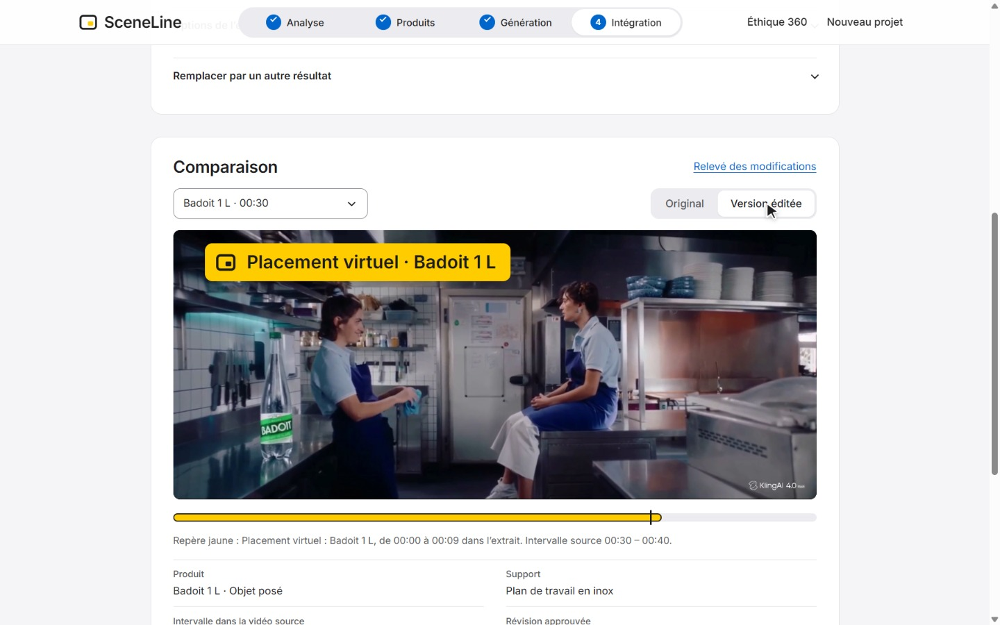
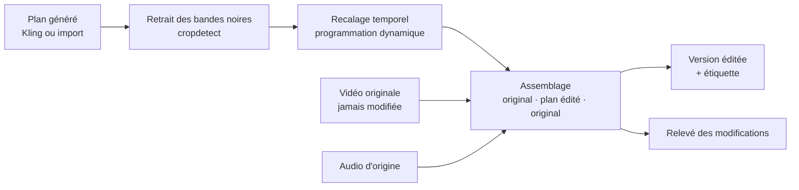

# Étape 4 · Intégration et transparence

> **Objectif :** replacer le plan généré dans l'œuvre **sans toucher à l'original**, garder l'audio d'origine,
> et dire clairement au spectateur ce qui a été modifié.

## Ce que voit le producteur
- Un lecteur **Original / Version éditée** sur le même extrait, avec une frise où le placement est surligné en jaune.
- Dans la version éditée, l'étiquette **« Placement virtuel · [Produit] »** reste affichée pendant toute la durée
  du placement.
- Une fiche qui détaille l'outil utilisé, l'approbateur, la date, le recalage et les empreintes.
- Le **relevé des modifications** (JSON) à joindre à la version éditée.

## Le pipeline

Code : [`integration/render.py`](../../src/integration/render.py).

## Recalage temporel : les gestes restent sur le dialogue
Un outil génératif peut rendre un plan plus long ou plus court, ou accélérer une partie du geste. Poser ce plan
tel quel désynchroniserait l'image et le dialogue d'origine.

`retime()` aligne **chaque image de l'original** (25 i/s) sur l'image du plan généré qui lui ressemble le plus,
**hors de la zone du produit**, sous contrainte d'ordre (programmation dynamique, comme un alignement de
séquences). Les gestes retombent ainsi sur le rythme du dialogue d'origine, et l'écart moyen de synchronisation
est mesuré et affiché. Dans la démonstration, un plan généré de 7,0 s a été recalé sur l'intervalle de 9,5 s
de l'original.

## Assemblage
- Les **bandes noires** ajoutées par un outil (un 16:9 autour d'un plan large) sont détectées et retirées
  automatiquement.
- L'extrait final est : **1 s d'original avant** → **plan édité** sur l'intervalle approuvé → **1 s d'original
  après**, avec l'**audio source conservé** de bout en bout.
- **La vidéo doit être celle de ce placement.** Avant d'intégrer, SceneLine compare la vidéo importée au plan
  d'origine sur cinq instants. Si un autre placement lui ressemble nettement plus, l'import est refusé et
  SceneLine nomme le bon placement ; une vidéo très transformée peut être importée quand même, à la demande du
  producteur, et le relevé le note. Un placement sans kit ni image de référence n'a pas encore de vidéo : aucun
  import n'est proposé. Un résultat intégré par erreur peut être retiré.
- Seule la **révision approuvée** d'une proposition peut recevoir un rendu, et le rendu lui est lié par
  son empreinte.

## Le relevé des modifications
Chaque version éditée est accompagnée d'un relevé qui liste, pour chaque placement : le produit, le support,
l'intervalle source, la révision et son **empreinte SHA-256**, l'**approbateur et la date**, l'**outil qui a produit
l'image** (`generated_by_sceneline: false`), l'empreinte du prompt du kit, le traitement de l'audio, le recalage
et les avertissements. Le relevé précise qu'il ne remplace pas les obligations légales de signalement du
placement de produit.
