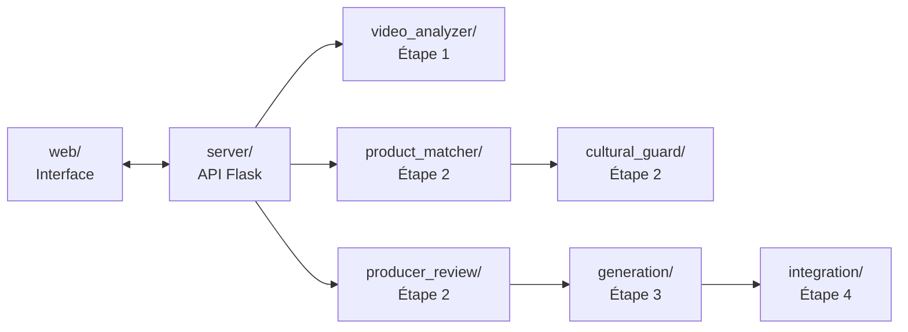

# `src/` · le code de SceneLine

Le code est organisé **par étape du parcours**. Chaque dossier est un module Python autonome, avec son propre README.



| Dossier | Étape | Rôle |
|---|---|---|
| [`server/`](server) | — | Serveur Flask, API REST, file de travaux, garde d'hôte |
| [`video_analyzer/`](video_analyzer) | 1 · Analyse | Plans, dialogue, scènes, protection, surfaces, règles de décision, client Gemini |
| [`product_matcher/`](product_matcher) | 2 · Produits | Catalogue, provenance des visuels, règles d'appariement, classement |
| [`cultural_guard/`](cultural_guard) | 2 · Produits | Cultural Integrity Guard : cinq critères, cohérence géographique |
| [`producer_review/`](producer_review) | 2 · Produits | Propositions, révisions, décisions signées avec empreinte |
| [`generation/`](generation) | 3 · Génération | Kit de génération, génération Kling AI avec accord par placement |
| [`integration/`](integration) | 4 · Intégration | Recalage temporel, assemblage, audio d'origine, relevé des modifications |
| [`evaluation/`](evaluation) | — | Comparaison des placements avec une annotation manuelle |
| [`web/`](web) | 1 → 4 | Interface HTML, CSS et JavaScript, sans framework |

## Dépendances entre modules
Les dépendances vont toujours de l'étape vers ses fondations, jamais l'inverse :

```
server ──► generation ──► integration ──► producer_review ──► product_matcher ──► video_analyzer
                                                 │                    │
                                                 └──► cultural_guard ◄┘
```

## Lancer
Depuis la racine du dépôt : `python run.py --port 8000`. Le point d'entrée [`run.py`](../run.py) ajoute `src/` au chemin
d'import ; les étapes d'analyse lourdes tournent dans des processus séparés (`video_analyzer/analyze.py`,
`video_analyzer/understand.py`) pour garder le serveur réactif.
