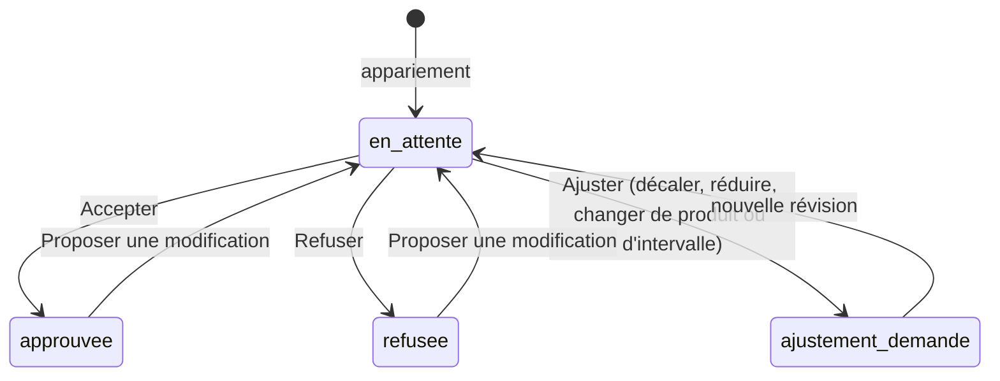

# `producer_review/` · Propositions et décisions signées

> **Rien n'est modifié sans l'accord du producteur**, et chaque accord est traçable.

## Fichier

| Fichier | Rôle |
|---|---|
| [`decisions.py`](decisions.py) | Crée et révise les propositions à partir de l'appariement, enregistre les décisions, applique les ajustements |

## Le cycle d'une proposition

## Traçabilité
- Chaque décision enregistre **l'approbateur, la date, le commentaire** et l'**empreinte SHA-256** (`digest()`) de la
  révision décidée.
- Une révision modifiée après approbation **n'hérite pas** de l'accord : elle doit être décidée à son tour.
- Chaque proposition garde son **origine** (placement de l'étape 1, score, raison) et l'historique complet.
- Un refus ne déclenche aucun rendu ; seule une révision approuvée peut être générée et intégrée.

📖 Détails : [docs/etapes/2-produits-et-guard.md](../../docs/etapes/2-produits-et-guard.md)
